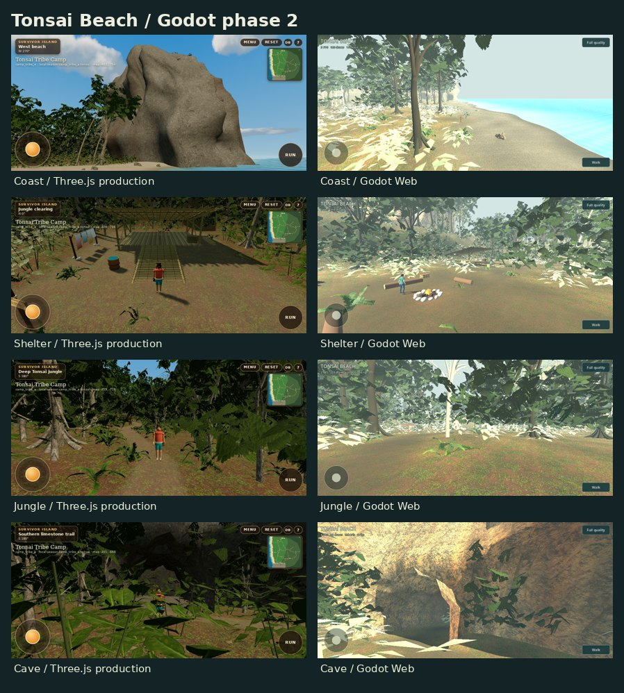
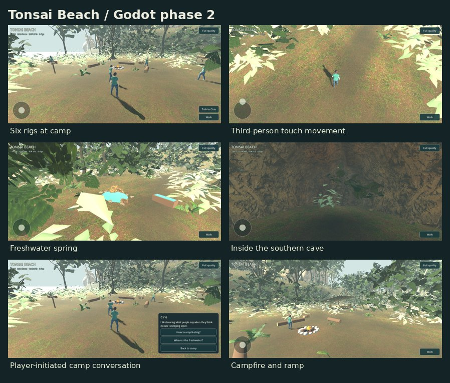

# Return to Tonsai

Phase 2 moves the established Tonsai camp into Godot 4.7.2 Compatibility. There are six copies of the public-safe Maeve rig for player and NPC testing. The names identify provisional simulation actors.

| Starting point | Commit |
| --- | --- |
| Main at initial audit | `191e5c6e8c636c892c6fee4dab7d203b744658a8` |
| Character Lab PR #1 head | `fa74dc1f79c32cbe6b0ba44900f5f8b51548a8e8` |
| Main after the PR #1 merge, Phase 2 base | `7afb665a47a782e2c64bb5d345ade960f8501e1c` |
| Three.js Tonsai sources | `708a21c43b4b2969aa28bf2142005e4f5df0bcdf` |
| SurvivorIsland2025 social reference | `cf894e578d77fce1e588d793dfc8d14f61ec7628` |

## Camp and movement

- `tools/tonsai/prepare.mjs` evaluates pinned, checksum-verified authored TypeScript world modules offline. Godot receives a 260 × 237 one-meter heightfield, 201 × 191 m territory, +X east, +Z south, 12 trails, landmark and prop coordinates, and 39 candidate records including approaches. No JavaScript game code runs in Godot.
- The shipped low kit provides the original shelter, limestone cliff and cave, scanned rock, forest, coastal tree, palms and ferns. Godot consumes original vertex colors, texture alpha masks and world transforms. The ground shades use scanned sand and litter, original trail wear and baked canopy tint. Water and sky use native Compatibility shaders. Foliage uses 34 m spatial batches. Economy shortens understory draw range and disables direct shadows.
- `CampHumanoidMotor` supplies capsule movement with grounding, short step probes, turning and the PR #1 animation tree. `CampThirdPerson` adds the swept-sphere SpringArm camera. Touch ownership is tracked per finger, with cancellation on focus, tab visibility and viewport size changes.
- Navigation is baked offline with the heightfield, shelter ramp and deck, and conservative obstacle margins. The cliff and cave use the authored far mesh for physical walls. The terrain and major props use simpler shapes. NPCs use a NavigationAgent3D with arrival detection and stall recovery.
- `CampSimulation` represents actor identities, reservations, travel, arrivals, activity dwell and participant-owned conversation history outside the scene. The provisional provider has no alliances or relationship math. It draws on the 2D project's `CampSocialResolution`, `CampPresence` and `SocialMemorySystem` separation of physical presence, intention and observer-scoped knowledge. Activity state persists through dialogue interruption in one play session. Save/load and the season simulation remain future work.

## Asset ledger

| Sources | Usage |
| --- | --- |
| [Pinned camp provenance and credits](https://github.com/sunsetseast/SurvivorIsland3Dprototype/blob/708a21c43b4b2969aa28bf2142005e4f5df0bcdf/artifacts/survivor-camp-prototype/src/assets/camp/provenance.json) | CC0 Poly Haven boulder, island tree, sand and forest-floor scans. The SHA-256 input list is `tools/tonsai/inputs.json`. |
| [Reconstruction assets](https://github.com/sunsetseast/SurvivorIsland3Dprototype/blob/708a21c43b4b2969aa28bf2142005e4f5df0bcdf/docs/tonsai-reconstruction/ASSETS.md) | Project-authored shelter, woodland and landmarks. Use `reconstruction-low.glb` and `landmarks-low.glb` from the production loader. |
| [Coastal assets](https://github.com/sunsetseast/SurvivorIsland3Dprototype/blob/708a21c43b4b2969aa28bf2142005e4f5df0bcdf/artifacts/survivor-camp-prototype/src/assets/tonsai/coastal-manifest.json) | Low coastal foliage and fern scans with original credits. The renderer reuses the production palms kit. |
| [Character Lab asset ledger](../phase1/PIPELINE.md) | Maeve runtime GLB and Quaternius motions from PR #1. |

The original gallery shows fuller understory transitions, more cliff planting and refined shoreline lighting. This port keeps the authored silhouettes and trails, with a simpler surf and fewer small props and plants. Performance on the physical iPhone is open. The 39 hiding sites are migration data, with no idol spawning, discovery or ownership.

## Reproduce and test

Use Node 24, Python 3 and the pinned Godot template.

```sh
bash ci/install-godot-web.sh
bash ci/build-web.sh
bash ci/build-character-lab.sh
bash ci/build-tonsai.sh
python3 tools/tonsai/review_web.py build/tonsai build/tonsai-captures
```

Run `build-tonsai.sh` first to fetch inputs and bake navigation before opening `tonsai/camp.tscn` in the native editor. `TONSAI_REFERENCE=/path/to/SurvivorIsland3Dprototype` uses a local read-only checkout with the same checksums. The browser harness needs Playwright Chromium and starts its own loopback HTTP server. Normal Web play opens `index.html` via HTTPS. The review harness adds `?review` for deterministic camera captures.

The Tonsai workflow uploads `survivor-island-tonsai-web` rather than deploying. For an isolated iPhone preview on the existing Pages site, authorize adding the tested artifact as the `tonsai/` directory of the same full Pages deployment, alongside the current root files. A separate HTTPS static host can serve the contents of the Web artifact directly. Keep the directory's HTML, JS, PCK, WASM and worklet files together. Serve WASM as `application/wasm`. The build uses a single thread.

### iPhone 17 Pro Max

1. Open the authorized HTTPS preview in Safari, turn off orientation lock, and rotate to landscape.
2. Talk to the nearby contestant, pick a question and close the dialogue. Try the left stick and right-half orbit together. Lift each thumb and verify its control stops. Tap Walk to switch to running.
3. Walk up the shelter ramp, then follow the trail east to freshwater. Follow the beach south to the cave. Watch for wall clipping, stuck NPCs, or animation sliding.
4. Record load time, FPS during movement, and any stalls at Full quality and Economy. Switch Safari tabs and rotate twice to check input cancellation. Aim for 60 FPS and use 30 FPS as the fallback threshold for device acceptance.

## Verification and environment review





Headless Godot completed approximately 387 m of continuous physical traversal through the shelter ramp and deck, camp trail, beach, freshwater spring, quiet alcove and cave. The route isolates physical terrain from temporary NPC congestion. Separate tests cover participant-only memory, NPC interruption and resumption, cave wall collision, and the camera pitch limits. Standalone Chromium testing covers six rigs, a touch-initiated conversation, simultaneous movement and camera orbit, and movement cancellation on release.
