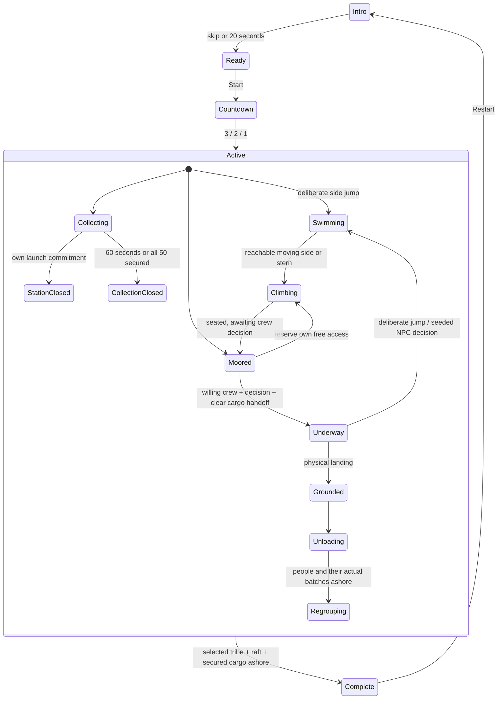

# Continuous marooning design

This implements the Phase 4D.3.2 opening only. Draft PR #17 stays unmerged; no Day 1 system, persistent inventory, new account service, production save or new camp map is introduced.

## State and ownership

`MarooningPreview` owns the only scene physics coordinator. `MarooningSession` owns a fixed 1/60 second monotonic gameplay clock, a shared contestant dictionary, the 50-instance ledger and an ordered semantic journal. The adapters cannot advance clocks or recreate contestants. Motors remain the existing physical capsule controllers; RVO safe velocity drives actual movement. Confirmed `arrived` is monotonic and separate from current locomotion, shore activity and player input.

Each step completes supply commands in due-time/stable-ID order, including completions exactly at 60 seconds, closes the global collection window when required, evaluates each tribe's launch, locks its own station and cancels unfinished actions, then resolves local moving climbs, stroke impulses, vessel movement, reward and arrival. Launching one tribe cannot close another tribe's station. Leaving ordinary held supplies sets down those exact IDs at the last validated deck position; it never adds them to a raft.

A completed bin deposit owns its exact item. A visible individual haul follows the bin/gate/side ramp/stern connection for 3.5 seconds. The raft waits for its own committed cargo handoff; this is not a second global assembly timer. Mass moves to the raft after that handoff and off it when a physical unloading carrier disembarks. Landing batches retain their original IDs; shore confirmation delivers those IDs once.

## Travel and decisions

Each raft is independently moored, underway, grounded or regrouped. Attribute- and seed-derived collection intentions, readiness, willing paddlers, leadership, opponents, swimmers and human encouragement affect a short departure decision. Human encouragement records its first timestamp and caller; nearby NPCs reconsider collection after a bounded 1.5–5 second attribute-based response, and repeated taps cannot postpone it. NPCs prefer at least two paddlers; after the collection deadline a minimal willing crew can depart after a short grace. Empty or resting crews produce no force. Human rest and jump are explicit choices.

The bow is visibly closed and collidable. Open side gates use identical clipped visible/collision triangles, matching timber ramps and real water access. The basket is clear of the gate. NPCs can choose distinct takeoff points around local congestion. The HUD explicitly communicates that jumping commits the player to water travel; it does not promise a return climb through the hull.

A climb reserves an own-tribe access, capacity and seat. It follows the raft's moving local frame through a central aisle to a unique seat. Completion validates the reservation and current geometry, rather than distance to the obsolete world-space start. Relative velocity is checked at initiation. Jumping inherits vessel travel during the physical arc; it does not erase crew momentum or create a second membership.

Accepted strokes deliver a finite 0.65 second impulse envelope. Perfect/Good/Mistimed multipliers are 1.5/1.1/0.65 on the same strength, laziness and fatigue formula. A late accepted stroke finishes across the beat boundary. One stroke per 1.6 second cycle, a minimum recovery interval, rest cancellation and delivered/cancelled impulse accounting prevent spam and stale power. Synchronization uses actual recent stroke phases and contributes at most 17%. Speed and distance use actual unblocked displacement. Hull collision checks include oriented raft separation and a scene body query; turns cannot rotate through a blocked neighbor. A blocked turn retries a separately collision-checked translation at the previous heading, so a stern sweep cannot discard valid outward travel. Once the reward resolves, potentially intersecting routes retain their original approach side and use separate outboard dock lanes, with neighbor avoidance active. The physical progress window requires actual collision evidence and less than0.35m displacement over3s; tiny successful steps cannot reset it. A blocked corner may backwater up to3.5m using accepted stroke force and continuously checked hull motion, with reversed paddle sweeps and explicit feedback/events. It neither relocates the hull nor awards route progress or cargo. At most three such physical attempts are permitted.

The single fishing package is available from the start. A swimmer or raft may claim it atomically; an actual carrier or vessel owns its mass. Other contestants redirect after the first claim. An explicit 150 second unclaimed outcome redirects travel without inventing a winner.

Landing uses a broad dry region, staggered non-collinear activity goals and meaningful radii. People physically swim, wade and walk from outboard exits; disembark feet cannot start below the sloping seabed. Arrived NPCs brake to idle or walk to a loose activity area. The player retains walk/look while regrouping. Completion requires the selected tribe's people, grounded raft and every secured cargo ID; rival outcomes remain explicit and may be unresolved at this preview boundary.

## Recovery

Progress checks distinguish route progress from motion against obstacles. Deck recovery repaths, releases/rotates unloading reservations, validates capsule-clear physical retreats and does not reset its immobility clock merely because a target changes. Measured lateral static contacts also feed bounded deck obstacle markers to RVO: the navigation mesh alone does not teach avoidance about imported ship walls. A retreat tests body travel, real floor height and full capsule occupancy, and still uses the computed safe velocity. Water/shore recovery tries local physical alternate goals. Below-surface height failure also counts as no progress even at zero horizontal goal distance. A catastrophic NPC-only surface repair after the same measured retry threshold starts outside arrival range, behind/aside by8.5m, and awards nothing; physical return is still required. All water exit endpoints are raised above the real bed before flight, including voluntary exits immediately before grounding.

Only after 45 seconds without route progress and at least eight measured retries may an NPC receive a local, collision-checked fade assist. It cannot move a human, move forward toward an objective, enter reward/arrival range, award cargo or fabricate completion. The result logs actor, from/to, reason, attempts, time, cargo handling and reward-carrier status. Ordinary journeys are tested separately and must not rely on that exceptional fixture.

## Transient handoff version 2

The scene metadata `marooning_result` contains:

- Original configuration, all stable contestant IDs, catalog fingerprint, seed and supply/travel RNG states.
- All 50 unique dispositions, explicit quantity/unit/mass and definition version, secured tribe and physical location (`loading`, `raft`, unloading carrier or shore), contributions and routes.
- Per-tribe launch time/reason, crew, actual travel, mass/draft, delivered IDs and honest arrival state.
- Exclusive reward ID, claimant, method, time, mass, carrier/location and claimed or unclaimed outcome.
- Per-contestant stroke quality/counts, accepted/delivered/cancelled N·s, fatigue, swim distance, boardings, departures and confirmed arrival.
- Shared clock owner, collection closure/station locks, bounded semantic journal, explicit recoveries and implementation provenance.

This dictionary is not saved to a season, profile, cloud slot or database. Restart and exit cancel input, release scene ownership, clear handoff state and restore the prior global physics policy. The previous 120-step catch-up setting is removed; the scene uses at most the existing eight-step limit.
